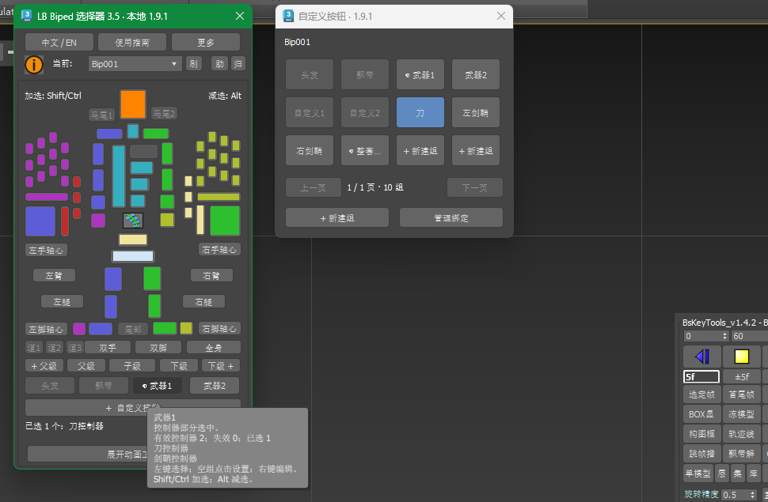

# Zhuoyu Biped Tools

面向 3ds Max 角色动画的 Biped 控制器选择器扩展。基于 **Lorne Brooks 的 Biped Helper + Picker 3.5**，由 Zhuoyu 按实际动画测试中的选骨、换绑与道具动画需求迭代，使用 Codex 协作实现和排查。



- **自定义控制器组**。把刀、左右剑鞘、头发或飘带分组，点击按钮即可取回整组选择。按钮支持命名、分页、拖动排序和悬浮状态提示。
- **重绑定内置色块**。视口预选一个或多个节点后，右键单击或左键双击色块，载入预选、核对列表、应用绑定。应用后在视口显示结果。
- **配置随场景保存**。同一场景的不同 Biped 各自保存选择映射。1.9.8 将旧记录迁移为弱引用，修复选择记录造成的 Link／Unlink 循环依赖。

## 安装 1.9.8

1. 从 [GitHub Release](https://github.com/Elviszhuoyu/Zhuoyu-Biped-Tools/releases/tag/v1.9.8) 下载并解压 `Zhuoyu_BipedTools_1.9.8_Windows.zip`。
2. 从 [Lorne Brooks 的 ScriptSpot 发布页](https://www.scriptspot.com/3ds-max/scripts/biped-helper-picker) 下载 **3.5** 的 `lbtools_biped_helper.mzp`。原站也可能保存为 `lbtools_biped_helper_0.mzp`。
3. 在解压目录打开 PowerShell，运行下面的命令，将参数换成原版 MZP 的实际路径。生成的安装包在 `dist` 文件夹。

   ```powershell
   powershell.exe -NoProfile -ExecutionPolicy RemoteSigned -File .\Build-Mzp.ps1 -UpstreamMZP "C:\Downloads\lbtools_biped_helper.mzp"
   ```

4. 在 3ds Max 中用 **脚本 → 运行脚本（Scripting → Run Script）** 打开生成的 `Zhuoyu_BipedTools_1.9.8.mzp`，确认选择器标题显示 **本地 1.9.8**。安装后可从 **Zhuoyu Biped** 宏分类添加工具栏按钮。安装包也提供拖入视口的入口。

PowerShell 如提示文件来自互联网，查看脚本后可在 Windows 文件属性里解除该脚本的下载阻止，再用原命令执行。发布 ZIP 已含两套本插件的 .NET 辅助 DLL。直接从源码构建需要 Windows 的 .NET Framework 4.x 编译器和能够构建 `net8.0-windows` 的 .NET SDK。

原版 3.5 安装包的 SHA-256 为 `5bfdc9ae404dda50740405d1eb54b3b9d42b7fd18bdcef87cf6f43c1e7363f70`。构建脚本从该包读取原版图标和上游轨迹辅助函数，并将它们组装进本地安装包。

## 上手流程

1. 在选择器顶部确认当前角色，点 **＋自定义按钮 → ＋新建组**，命名为「整套武器」。
2. 在视口选中刀和剑鞘的控制节点，打开该组的绑定管理，点 **使用视口所选（多个）**。回到选择器单击组按钮，核对视口高亮。
3. 要修正内置色块时，先在视口选好目标，再右键单击色块。使用 **载入视口选择 → 应用绑定**。需要恢复默认映射时，使用 **恢复自动识别**。
4. 保存 `.max`，关闭并重开后核对选择。迁移旧工程时先另存副本。

安装后点击选择器上的 **使用指南** 可打开离线手册。也可在本地浏览器打开 [Guide.html](BipedTools/src/Guide.html)。

诊断功能默认关闭。主动开启时，诊断数据保存在本机。

## 验证范围

GitHub 发布 ZIP 使用从 ScriptSpot 下载的原包完成本地打包，并在独立 3ds Max 2020 中通过安装、创建双节点组、一键选择及保存重开检查。

1.9.8 的既有回归在独立 **3ds Max 2020** 环境完成，覆盖安装、冷启动、绑定保存重开、旧记录迁移和 76 个内置色块。另在动画工程副本中对比了 385 个节点在 0–250 帧的变换、蒙皮权重和 9 个采样帧的变形顶点。该样本的变换矩阵与采样顶点差值均为 0。整段操作通过 Max API 和窗口事件入口执行，实体鼠标逐键、拖入安装和其他 Max 年份仍需各自验证。

## 来源与署名

- 原始脚本和原版图标来自 **Lorne Brooks** 的 [Biped Helper + Picker 3.5](https://www.scriptspot.com/3ds-max/scripts/biped-helper-picker)。原脚本第 118 行明确允许修改及分发该脚本，原作者与版本记录保留于中英文脚本。
- 上游表面轨迹辅助函数改编自 **Clavery** 的 [ClaverTech_AlignToSurface](https://www.scriptspot.com/3ds-max/scripts/clavertech-aligntosurface)。构建时从原版安装包读取该函数并保留署名。
- 本仓库记录 Zhuoyu 的扩展实现与文档，发布沿用上述来源的各自声明。

